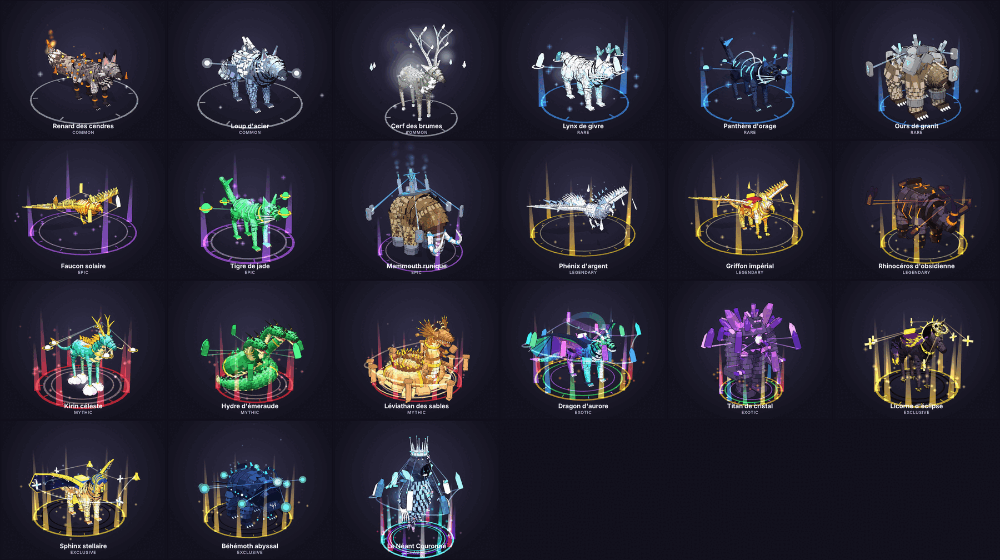
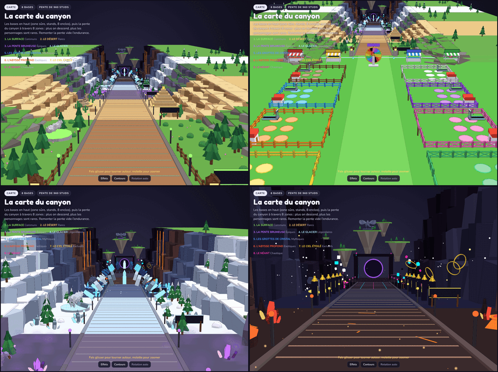
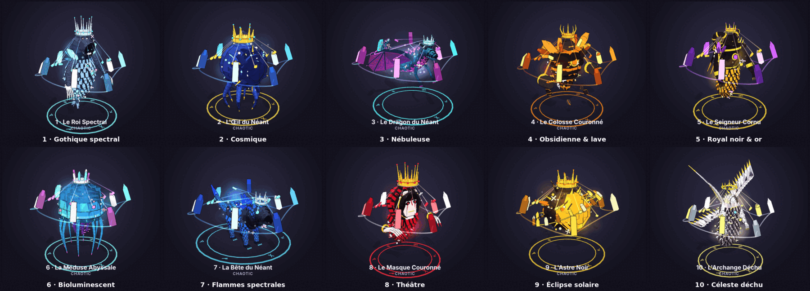
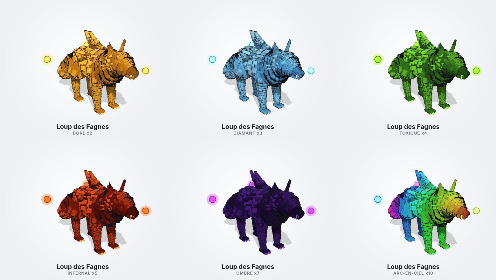
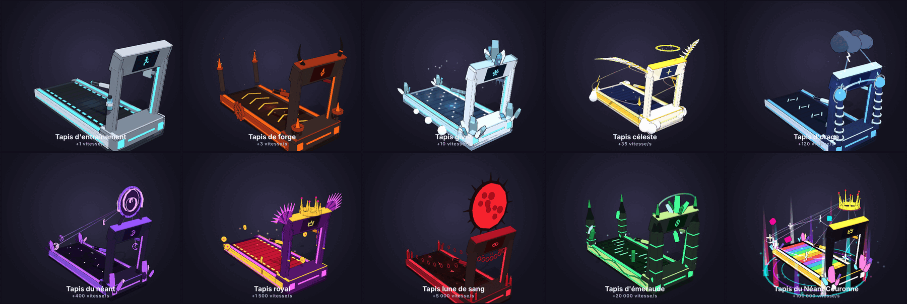
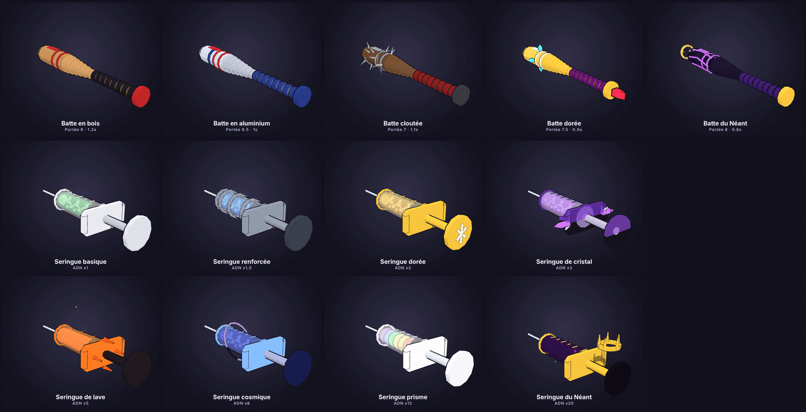
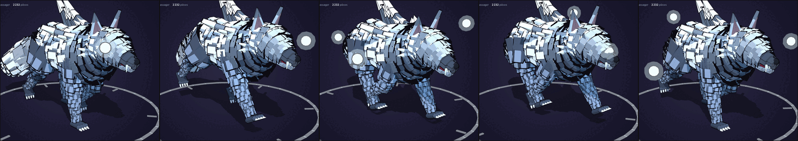

# CreatureForge — les personnages, la carte et les tapis du jeu

Les **21 personnages** du jeu (récap du 1er nov. 2026), dont le Néant Couronné en **10 variétés**, assemblés **entièrement en code Luau** dans
le style « low-poly détaillé » : des centaines d'écailles, de mèches de fourrure, de plumes et
d'épines (Part / WedgePart), des matériaux Roblox (SmoothPlastic, Slate, Granite, Marble, Basalt,
Sand, Wood, Fabric, Grass, Glass, Metal, Neon), des ornements (armures d'or, runes lumineuses,
cristaux), des objets qui gravitent autour d'eux, des particules et des lumières. Chacun est
articulé (Motor6D), animé, a son **icône UI**, une **selle** (monture) et, pour les grands, une
**selle passager**. Les **8 raretés** et les **11 mutations cumulables** sont prises en compte.

## Bestiaire animé

`tools/preview/bestiaire.html` affiche la carte, les 10 tapis de course, les battes, les seringues et les 30 modèles de créatures (21 personnages, dont 10 variétés du Néant) en 3D, **animés** (repos, marche,
capacité spéciale, figé), classés par rareté, avec leurs stats (taille, argent de base, bonus de
vitesse, passager) et les **mutations cumulables** (le revenu se calcule en direct). C'est le même
animateur que dans le jeu, porté en JavaScript. En local :
`cd tools/preview && python3 -m http.server 8000` puis http://localhost:8000/bestiaire.html
(une version en ligne est publiée en Artifact sur claude.ai).



## La carte du jeu



`src/shared/Map.luau` construit la carte (≈ 12 900 pièces, déjà enregistrée dans
`dist/CreatureForge.rbxl`, et dans `dist/models/Carte.rbxm`) :

- **Les bases, style Roblox** : un grand champ vert avec **8 enclos** aux clôtures de couleurs
  différentes (planches ou croisillons). Chaque enclos a 6 places pour les créatures, un panneau au
  nom du joueur, une maisonnette et un tapis d'entraînement.
- **Les stands** à auvents rayés le long de la **ligne « ZONE SÛRE »** (dans les bases, on ne
  peut pas être frappé) : VENDRE, SERINGUES (avec le tableau du stock), TAPIS DE COURSE,
  GRATUIT !, et la ROUE de la chance qui tourne.
- **La pente** (960 studs, environ 6°) : un large chemin qui descend au fond du canyon, sans tapis
  roulant. Descendre est facile, mais remonter vide l'endurance. Il est bordé de falaises en
  terrasses, de lampadaires aux couleurs de chaque zone et d'un panneau par zone.
- **8 zones, une par rareté**, chacune avec ses décors et une statue de pierre :

| Zone | Rareté | Décor | Statue |
| --- | --- | --- | --- |
| 1. La Surface | Communs | herbe, sapins, clôtures, fleurs | Renard des cendres |
| 2. Le Désert | Rares | sable, pyramide à gradins, cactus | Léviathan des sables |
| 3. La Pente Brumeuse | Épiques | brume violette, améthystes | Kirin céleste |
| 4. Le Glacier | Légendaires | neige, sapins enneigés, arches de glace | Lynx de givre |
| 5. Les Grottes de Cristal | Mythiques | grands cristaux bleus, arches de cristal | Mammouth runique |
| 6. L'Abysse Profond | Exotiques | lave, cascades de feu, cristaux rouges | Rhinocéros d'obsidienne |
| 7. Le Ciel Étoilé | Exclusifs | nuit étoilée, obélisques d'or, anneaux flottants | Sphinx stellaire |
| 8. Le Néant | Chaotique | vide, lignes glitch, cubes flottants | Néant Couronné |

- **Tout au bout** : le portail du Néant, des îles flottantes et un dragon d'aurore dans le ciel.
- Le script serveur `Bases` donne un enclos à chaque joueur (panneau à son nom) et tient le
  tableau du stock de seringues à jour (stock + compte à rebours).

```lua
local Map = CreatureForge.Map
local d = Map.distanceOf(rootPart.Position)        -- 0 (haut de la pente) -> 1 (tout au bout)
Map.zoneOf(d).label                                -- "4. LE GLACIER"
local def, mutations = CreatureForge.rollSpawn(d)  -- apparition selon la profondeur
Map.isClimbing(rootPart.AssemblyLinearVelocity)    -- vrai quand le joueur remonte (endurance)
Map.isSafe(rootPart.Position)                      -- vrai dans la zone sûre des bases
```

## Raretés

| Rareté | Couleur | Où elle apparaît | Chance |
| --- | --- | --- | --- |
| Commun | Gris | La Surface | très fréquent |
| Rare | Bleu | Le Désert | fréquent |
| Épique | Violet | La Pente Brumeuse | moyen |
| Légendaire | Or | Le Glacier | peu fréquent |
| Mythique | Rouge | Les Grottes de Cristal et plus loin | rare |
| Exotique | Arc-en-ciel (animé) | L'Abysse Profond et plus loin | 1 sur 5 000 |
| Exclusif | Noir et or | Le Ciel Étoilé + roue | 1 sur 50 000 |
| Chaotique | Glitch (couleurs qui changent) | Le Néant | 1 sur 1 000 000 |

Chaque rareté a son **aura** autour des pieds (anneaux au sol, colonnes de lumière, particules),
de plus en plus riche ; l'Exotique est arc-en-ciel, l'Exclusif noir et or, le Chaotique glitch.
`Spawning.rollRarity(distance)` tire la rareté selon la profondeur dans le canyon
(`Map.distanceOf`) : chaque rareté normale suit une courbe en cloche, les raretés ultimes sont
tirées à part à partir de leur zone. `luck = 2` pour le boost « Chance x2 ». Valeurs à ajuster en test :

| Distance | Commun | Rare | Épique | Légendaire | Mythique |
| --- | --- | --- | --- | --- | --- |
| 0 (Surface) | 100 % | | | | |
| 0,2 (Désert) | 40 % | 60 % | | | |
| 0,4 (Glacier) | 3 % | 20 % | 41 % | 36 % | |
| 0,5 (Grottes) | 0,5 % | 6 % | 25 % | 43 % | 24 % |
| 0,7 (Abysse) | | 0,3 % | 4 % | 25 % | 71 % (+ Exotique 0,02 %) |
| 1 (Néant) | | | 0,1 % | 3 % | 97 % (+ Exotique 0,02 %, Exclusif 0,002 %, Chaotique 0,0001 %) |

## Les 21 personnages

| Personnage | Rareté | Taille | Argent de base | Vitesse | Passager | Points forts |
| --- | --- | --- | --- | --- | --- | --- |
| Renard des cendres | Commun | Petit | 5 $/s | +5 % | Non | fourrure grise, braises Neon dans le pelage, queue en feu |
| Loup d'acier | Commun | Moyen | 9 $/s | +7 % | Non | pelage en lames de métal poli, reflets du soleil |
| Cerf des brumes | Commun | Grand | 15 $/s | +8 % | Oui | bois de verre translucide, brume autour des bois |
| Lynx de givre | Rare | Petit | 50 $/s | +12 % | Non | fourrure blanche, cristaux de glace au bout des oreilles |
| Panthère d'orage | Rare | Moyen | 90 $/s | +15 % | Non | pelage noir, éclairs bleus, arcs électriques |
| Ours de granit | Rare | Grand | 140 $/s | +16 % | Oui | dos couvert de dalles de granit et de quartz |
| Faucon solaire | Épique | Petit | 500 $/s | +25 % | Non | plumes d'or, traînées de lumière |
| Tigre de jade | Épique | Moyen | 900 $/s | +28 % | Non | corps de jade sculpté, rayures lumineuses |
| Mammouth runique | Épique | Géant | 1 500 $/s | +30 % | Oui | défenses gravées de runes bleues, nacelle de menhirs |
| Phénix d'argent | Légendaire | Moyen | 6 000 $/s | +45 % | Non | flammes argentées, traîne de feu froid |
| Griffon impérial | Légendaire | Grand | 10 000 $/s | +55 % | Oui | mi-aigle mi-lion, armure d'or, selle de velours |
| Rhinocéros d'obsidienne | Légendaire | Géant | 14 000 $/s | +55 % | Oui | plaques noires brillantes, fissures de lave |
| Kirin céleste | Mythique | Moyen | 50 000 $/s | +80 % | Non | cheval-dragon de jade, sabots de nuages, crinière de flammes |
| Hydre d'émeraude | Mythique | Géant | 100 000 $/s | +95 % | Oui | trois têtes, trois cous qui ondulent, corps enroulé |
| Léviathan des sables | Mythique | Colossal | 150 000 $/s | +100 % | Oui | anneaux qui plongent dans les dunes |
| Dragon d'aurore | Exotique | Géant | 900 000 $/s | +150 % | Oui | écailles en dégradé d'aurore, ailes de verre teinté |
| Titan de cristal | Exotique | Colossal | 1,4M $/s | +160 % | Oui | golem de roche et de cristaux violets (démarche bipède) |
| Licorne d'éclipse | Exclusif (canyon + roue) | Grand | 8M $/s | +200 % | Oui | licorne noire, anneau de lumière autour de la corne |
| Sphinx stellaire | Exclusif (roue) | Géant | 11M $/s | +220 % | Oui | tête de pharaon, ailes remplies d'étoiles |
| Béhémoth abyssal | Exclusif (roue) | Colossal | 14M $/s | +240 % | Oui | leurre et photophores bleus, gueule aux dents-aiguilles |
| Le Néant Couronné (10 variétés) | Chaotique | Colossal | 100M $/s | +400 % | Oui | vide et étoiles, couronne qui flotte au-dessus de la tête |

Les données de jeu sont dans chaque définition : `Size`, `Income`, `SpeedBonus`, `Passenger`,
`Source` (`"Tapis"` = dans le canyon, `"TapisEtRoue"`, `"Roue"`). Les anciens modèles (Rat des Cavernes, Lézard
Mousseux…) sont conservés dans `src/shared/Archive/` mais ne sont plus dans le jeu.

### Les 10 variétés du Néant Couronné



Le Néant Couronné existe en **10 variétés**, chacune avec sa fiche dans l'Index : Roi Spectral
(gothique spectral), Œil du Néant (cosmique), Dragon (nébuleuse), Colosse (obsidienne et lave),
Seigneur Cornu (royal noir et or), Méduse Abyssale (bioluminescent), Bête du Néant (flammes
spectrales), Masque (théâtre), Astre Noir (éclipse solaire), Archange Déchu (céleste déchu).
Toutes ont la couronne qui flotte et un corps de vide constellé d'étoiles, et les mêmes stats
(100M $/s, +400 %, passager). Quand un Chaotique apparaît (1 sur 1 000 000), l'une des 10 est
tirée au hasard : chaque variété est donc à 1 sur 10 000 000. Définitions :
`src/shared/Creatures/NeantCouronne.luau` (un module, 10 créatures) ; modèles :
`src/shared/Concepts/NeantCouronneVariantes.luau`.

## Mutations



Chaque créature peut avoir **une ou plusieurs** mutations, visibles sur son modèle. Chaque
mutation est tirée indépendamment ; le revenu vaut **base × (multi1 + multi2 + …)**. Exemple :
Griffon impérial (10 000 $/s) + Vitrail (x2) + Kintsugi (x1,5) = 35 000 $/s.

| Mutation | Effet sur le modèle | Multi | Chance |
| --- | --- | --- | --- |
| Mousse ancienne | pierre grise couverte de mousse (matériau Grass) et de petites fleurs | x1,3 | 1 sur 8 |
| Kintsugi | porcelaine bleu et blanc, fissures remplies d'or lumineux | x1,5 | 1 sur 15 |
| Vitrail | verre coloré par panneaux, lumières colorées à l'intérieur | x2 | 1 sur 40 |
| Horloger | peau de laiton translucide, engrenages qui tournent dedans | x2,5 | 1 sur 80 |
| Mirage | couleurs de chaleur, corps qui ondule, ombre décalée au sol | x3 | 1 sur 150 |
| Encre | dessin noir et blanc, contour épais, traînées d'encre en courant | x3,5 | 1 sur 300 |
| Aurore | reflets d'aurore boréale qui défilent sur le corps, rubans d'aurore | x4 | 1 sur 600 |
| Fossile vivant | corps d'ambre translucide, squelette (os, côtes, crâne) visible | x5 | 1 sur 1 500 |
| Constellation | corps noir rempli d'étoiles reliées par des lignes | x7 | 1 sur 5 000 |
| Écho | une copie fantôme suit la créature avec une seconde de retard | x10 | 1 sur 20 000 |
| Paradoxe | change d'apparence de mutation toutes les 3 secondes | x15 | 1 sur 100 000 |

Quand plusieurs mutations sont cumulées, la plus rare impose ses couleurs ; les ajouts (fleurs,
fissures, engrenages, squelette, étoiles, ombre, fantôme) s'additionnent. Les effets animés
(engrenages, ondulation, aurore, écho, paradoxe) sont joués côté client par `Mutations.runtime`.

## Tapis de course (gagner de la vitesse)



Le joueur gagne de la vitesse en courant sur le mini tapis de sa base ; un meilleur tapis fait
gagner plus vite. 10 niveaux (`src/shared/Treadmills/`), chacun avec sa bande qui défile (os
`Belt`), son écran face au coureur, son emblème en façade et ses décors animés. Prix et gains sont
des valeurs de départ : les mutations cumulables font monter vite les revenus, donc les prix
suivent une progression d'environ x20 par niveau (`Treadmills.PRICE_MULTIPLIER` pour tout ajuster) :

| Niveau | Tapis | Thème | Prix | Vitesse gagnée / s |
| --- | --- | --- | --- | --- |
| 1 | Tapis d'entraînement | acier brossé, néon cyan, gourde et serviette | offert | +1 |
| 2 | Tapis de forge | fer noirci, chevrons de lave, échappements en feu, engrenages | 20K $ | +3 |
| 3 | Tapis givré | acier blanc, cristaux de glace, stalactites, neige | 350K $ | +10 |
| 4 | Tapis céleste | marbre et or, ailes de plumes, halo flottant, nuages | 6M $ | +35 |
| 5 | Tapis d'orage | bobines Tesla reliées par des arcs, nuage d'orage | 120M $ | +120 |
| 6 | Tapis du néant | obsidienne, portail en spirale qui tourne, croissants de lune | 2,5B $ | +400 |
| 7 | Tapis royal | pourpre et or, couronne, éventails de plumes, bannières | 50B $ | +1,5K |
| 8 | Tapis lune de sang | lune de sang qui tourne, chaînes, cierges, runes | 1T $ | +5K |
| 9 | Tapis d'émeraude | flèches gothiques aux flammes vertes, lianes lumineuses | 25T $ | +20K |
| 10 | Tapis du Néant Couronné | bande arc-en-ciel, couronne flottante, étoiles, aura Chaotique | 600T $ | +100K |

```lua
local Treadmills = CreatureForge.Treadmills
local tapis = Treadmills.spawn("TapisForge", baseCFrame)   -- le coureur regarde vers -Z
Treadmills.setRunning(tapis, true)                          -- la bande fait courir sur place
Treadmills.get("TapisForge").Gain                           --> 3 (vitesse gagnée par seconde)
Treadmills.nextOf("TapisForge")                             --> Tapis givré (prix, gain)
```

Chaque tapis contient une pièce `RunSurface` (collidable, ancrée, vitesse de convoyeur) : le
serveur vérifie que le joueur est dessus et bouge avant d'accorder le gain (anti-triche).

## Battes et seringues



- **Battes** (`src/shared/Weapons.luau`) : la batte en bois (de départ), en aluminium, cloutée,
  dorée et du Néant. Chacune a sa portée, son délai entre deux coups et son recul (valeurs de
  départ à ajuster). `Weapons.buildTool(id)` donne un `Tool` prêt à mettre dans le sac du joueur.
  Frapper un joueur fait tomber ce qu'il porte (créatures, ADN, seringue) ; le serveur doit
  vérifier la distance et le délai.
- **Seringues** (`src/shared/Syringes.luau`) : 8 niveaux, de la basique (ADN x1) à celle du
  Néant (ADN x20). ADN récolté = ADN de base de la rareté (Commun 1 ... Chaotique 10 000) ×
  multiplicateur de la seringue : `Syringes.dnaFor("SeringueDoree", "Legendary")` → 60.
- **Boutique de seringues** : elle se réinitialise **toutes les 5 minutes**. Chaque seringue a
  une chance d'être en stock, en quantité limitée :

| Seringue | ADN | Chance d'être en stock | Stock | Prix |
| --- | --- | --- | --- | --- |
| Basique | x1 | 100 % | 5–10 | 500 $ |
| Renforcée | x1,5 | 70 % | 3–6 | 25K $ |
| Dorée | x2 | 45 % | 2–4 | 500K $ |
| De cristal | x3 | 25 % | 1–3 | 10M $ |
| De lave | x5 | 12 % | 1–2 | 250M $ |
| Cosmique | x8 | 5 % | 1 | 5B $ |
| Prisme | x12 | 2 % | 1 | 100B $ |
| Du Néant | x20 | 0,5 % | 1 | 2,5T $ |

  `Syringes.stockAt(os.time())` ne dépend que du créneau de 5 minutes : tous les serveurs (et le
  tableau de la boutique) affichent le même stock au même moment.

## Animations



Toutes les pattes et tous les bras ont maintenant une articulation au milieu (genou, coude) : le
bas de la patte, le pied et les griffes suivent automatiquement l'articulation. L'animateur
(`CreatureAnimator`, et le même en JavaScript dans le bestiaire) fait :

- **quadrupèdes** : trot diagonal, le genou se plie quand la patte avance, le corps rebondit
  deux fois par foulée, tangue, roule et penche vers l'avant ; la tête hoche, la queue balance ;
- **bipèdes** (Titan) : pas lourds avec genoux, bras en balancier avec coudes ;
- **lévitation** (Néant Couronné) : buste qui s'incline, bras et coudes vivants, ailes ;
- **oiseaux** : battements d'ailes, pattes repliées en vol.

## Effets visuels (VFX)

Chaque créature combine une **aura de rareté**, des **effets signature** (braises, flocons,
éclairs, bulles, brume, poussière d'or…), des **traînées** au bout des ailes et des queues, des
**liens d'énergie** entre les objets en orbite et la créature, des lumières vivantes et une
**capacité spéciale** (`CreatureForge.playAbility(model)`) : onde de choc, dôme d'énergie,
souffle, gerbe d'éclats ou éruption, avec une pose de rugissement.

## Utilisation dans Roblox Studio

### Option 1 — Le jeu complet (le plus simple)

Ouvre **`dist/CreatureForge.rbxl`** dans Roblox Studio et appuie sur **Play** : les 21 personnages
se promènent dans la carte, chacun dans la zone de sa rareté ; environ un sur trois reçoit une ou
deux mutations. Les 10 tapis de course sont exposés sur la place des bases. Le bouton **Bestiaire** (en bas à gauche) affiche toutes les icônes.

### Option 2 — Une créature dans ta propre place

- **Command Bar** : copie tout `dist/<Créature>.commandbar.luau`, colle-le dans *View › Command Bar*,
  Entrée. Pour des mutations, change `local MUTATIONS = nil` en par exemple
  `local MUTATIONS = { "Kintsugi", "Vitrail" }` en haut de la partie « Entrée ».
- **Glisser-déposer** : `dist/models/<Créature>.rbxm` dans la vue 3D,
  `dist/icons/<Créature>_Icon.rbxm` sur `StarterGui`.

### Option 3 — Projet Rojo

```bash
rojo serve        # puis « Connect » dans le plugin Rojo de Studio
```

```lua
local CreatureForge = require(game.ReplicatedStorage.CreatureForge)

-- Apparition sur le tapis (côté serveur) : rareté selon la distance, créature, mutations
local def, mutations = CreatureForge.rollSpawn(0.8)   -- 0 = début du tapis, 1 = tout au bout
local model = CreatureForge.spawn(def.Id, CFrame.new(0, 0, -20), { mutations = mutations })
print(model:GetAttribute("Income"))                    -- base × (somme des multiplicateurs)

CreatureForge.setAnimState(model, "Move")              -- "Idle" | "Move" | "Still"
CreatureForge.playAbility(model)                       -- capacité spéciale (effets sur tous les clients)
CreatureForge.income("GriffonImperial", { "Vitrail", "Kintsugi" }) --> 35000
CreatureForge.buildIcon("GriffonImperial", frame, { mutations = { "Aurore" } })
CreatureForge.ofRarity("Exclusive")                    -- personnages d'une rareté
CreatureForge.Spawning.odds(0.5)                       -- chances de chaque rareté (affichage)
```

Options de `spawn` : `scale`, `mutations`, `outline` (contour Highlight, 31 visibles max),
`effects` (particules + lumières), `detail` (densité des écailles/fourrures, 1 = complète).

Chaque personnage a un `Seat` « Saddle » (monture) ; ceux qui ont `Passenger = true` ont aussi un
`Seat` « PassengerSeat » juste derrière. Le modèle porte les attributs `Income`, `SpeedBonus`,
`Passenger`, `Mutations` et `Multiplier` pour les systèmes de jeu.

## Performances

Les personnages font entre 1 000 et 3 800 pièces (soudées à un Root ancré, aucune physique simulée).
L'animation est faite côté client (`Motor6D.Transform`, zéro trafic réseau) et s'arrête au-delà
de 160 studs de la caméra. Les icônes utilisent un modèle allégé (`detail = 0.4–0.55`) et le
bestiaire ne les construit qu'à la première ouverture. Pour un jeu avec beaucoup de créatures à
l'écran, le visualiseur exporte chaque créature en **GLB/OBJ** (un maillage par matériau, couleurs
par sommet) à importer en MeshPart avec l'importateur 3D de Studio.

## Architecture

```
src/shared/                 -> ReplicatedStorage.CreatureForge
  init.luau                 registre, spawn / buildIcon / setAnimState / rollSpawn / income
  Kit.luau                  rig (os Motor6D), primitives low-poly, colonnes (spine),
                            tubes organiques + revêtements d'écailles / fourrure, ceintures
  Anatomy.luau              pattes, sabots, yeux, oreilles, cornes, dents, crêtes, flammes,
                            plumes, ailes, cristaux, engrenages, runes, orbites
  Mutations.luau            11 mutations cumulables (peinture, ajouts, runtime client)
  Spawning.luau             tirage des raretés selon la distance sur le tapis, format 1,5K / 2M
  Treadmills/               tapis de course : Base (châssis, bande, console), Models/ (10 niveaux)
  Map.luau                  la carte : bases style Roblox, stands, pente du canyon, 8 zones, statues
  Weapons.luau              les battes (modèles + Tool)
  Syringes.luau             les seringues (modèles + Tool), ADN, boutique toutes les 5 min
  Vfx.luau                  aura de rareté, rayons (Beam), traînées (Trail), capacités spéciales
  Fx.luau                   particules et lumières (textures moteur, aucun asset à téléverser)
  Icon.luau                 carte d'icône (UICorner, UIGradient, UIStroke, ViewportFrame)
  Rarity.luau               8 raretés (Commun -> Chaotique), couleurs animées, tailles
  Types.luau                contrat CreatureDef / AnimProfile / IconTheme
  Creatures/                un personnage = un ModuleScript (auto-enregistré)
  Concepts/                 modèles des 10 variétés du Néant Couronné
  Archive/                  anciens modèles (non enregistrés)
src/client/                 CreatureAnimator (démarches Quadruped, Sprawler, Flyer, Serpent,
                            Hover, Biped + orbites + capacités + lumières + mutations), CreatureBestiary (UI)
src/server/                 CreatureShowcase (démo : créatures dans leur zone, tapis exposés),
                            Bases (un enclos par joueur, tableau du stock de seringues)
tools/                      export.luau, bundle.luau, build_place.luau,
                            preview/bestiaire.html (bestiaire animé), preview/viewer.html (aperçus)
```

### Régénérer `dist/` et les aperçus

Nécessite [Lune](https://github.com/lune-org/lune) (`cargo install lune`) :

```bash
lune run tools/export        # dist/models, dist/icons, données d'aperçu
lune run tools/bundle        # dist/<Créature>.commandbar.luau
lune run tools/build_place   # dist/CreatureForge.rbxl
cd tools/preview && python3 -m http.server 8000
# http://localhost:8000/viewer.html?id=GriffonImperial&mut=Kintsugi,Vitrail
#   (mutations, VFX, vues, export GLB/OBJ ; ajoute &bg=dark pour un fond sombre)
```
