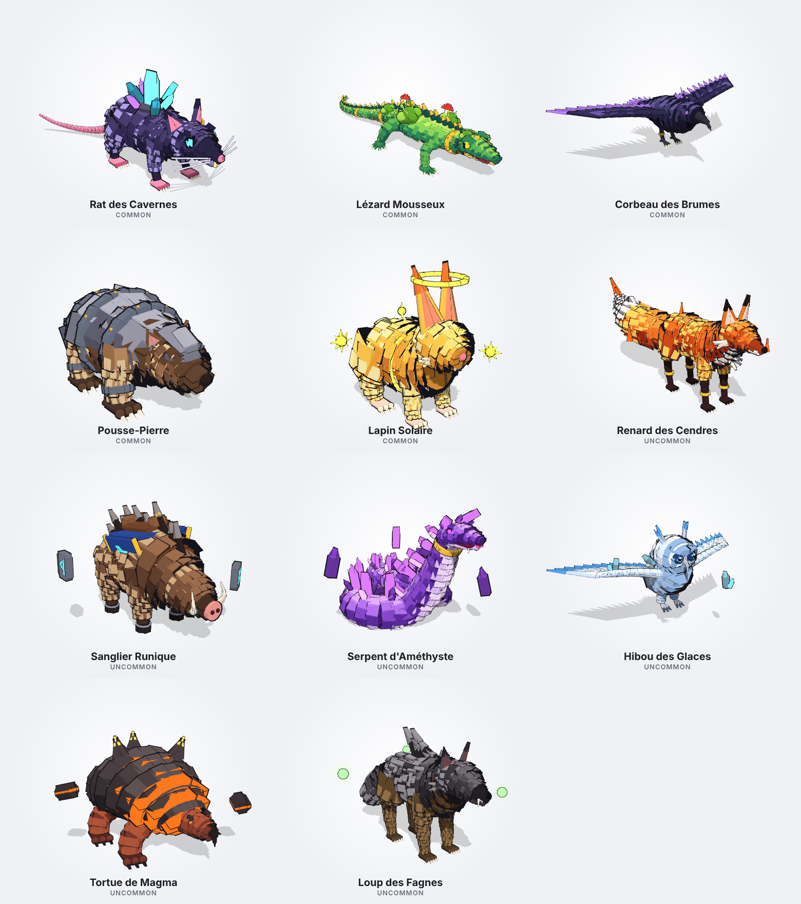
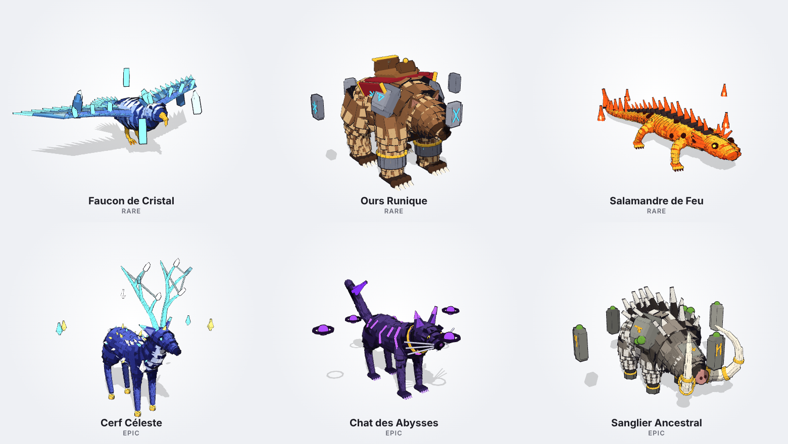
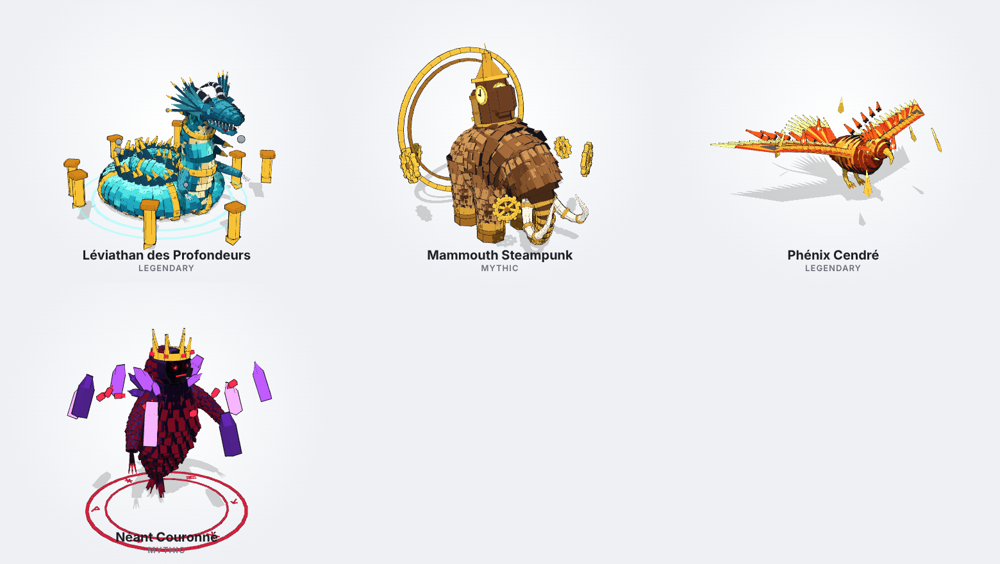
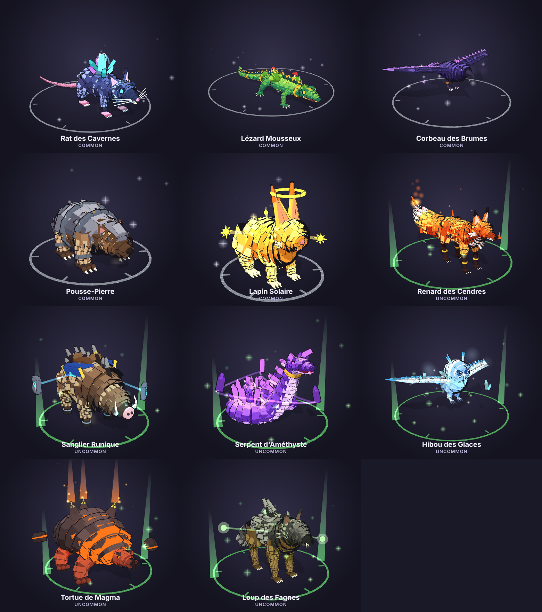
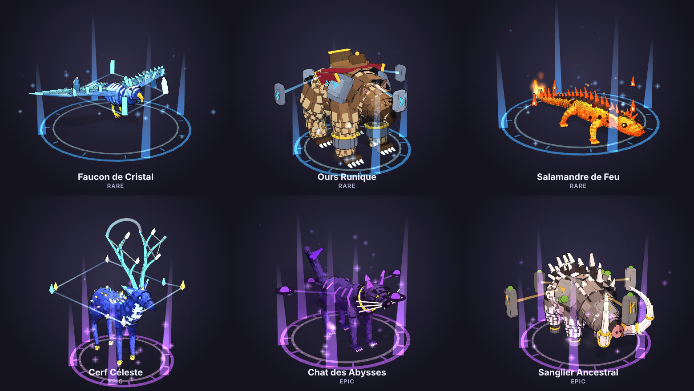
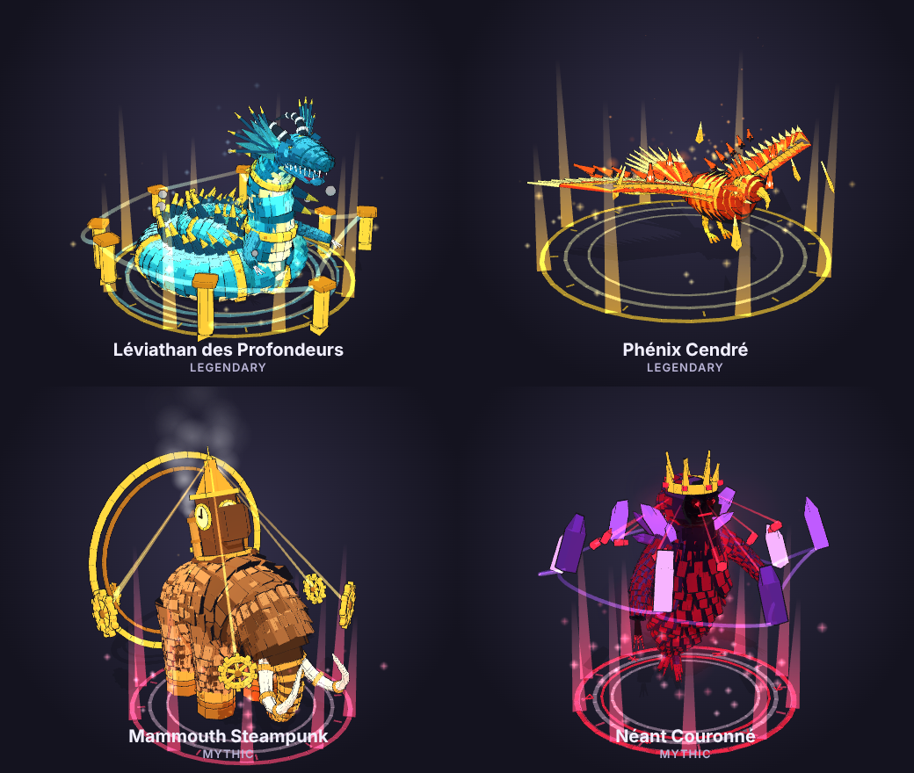

# CreatureForge — bestiaire low-poly pour Roblox

Les 21 créatures du jeu, assemblées **entièrement en code Luau** dans le style « low-poly détaillé » :
des centaines d'écailles, de mèches de fourrure, de plumes et d'épines (Part / WedgePart), des
matériaux Roblox (SmoothPlastic, Slate, Wood, Fabric, Grass, Glass, Metal, Neon), des ornements
(ceintures et bagues d'or à rivets, runes lumineuses, cristaux, engrenages), des objets qui
gravitent autour d'elles, des particules et des lumières. Chacune est articulée (Motor6D), animée,
a son **icône UI** (UICorner + UIGradient + ViewportFrame) et accepte les **6 mutations**.

> Aperçus rendus hors de Studio par `tools/preview/viewer.html` (ombrage cartoon + contour noir
> sur chaque pièce, comme ton visualiseur de référence). Dans Roblox, seul le contour extérieur
> est dessiné (Highlight) et l'éclairage dépend de ta carte.

## Bestiaire animé

`tools/preview/bestiaire.html` affiche les 21 créatures en 3D, **animées** (repos, marche,
capacité spéciale, figé), avec les mutations, les particules, les rayons et les traînées. C'est le
même animateur que dans le jeu, porté en JavaScript. En local :
`cd tools/preview && python3 -m http.server 8000` puis http://localhost:8000/bestiaire.html
(une version en ligne a aussi été publiée en Artifact sur claude.ai).

## Zone 1 — La Surface (Communs & Inhabituels)



## Zone 2 — La Pente Brumeuse (Rares & Épiques)



## Zone 3 — Les Grottes de Cristal (Légendaires & Mythiques)



## Mutations


| Mutation | Chance | Valeur | Effet |
| --- | --- | --- | --- |
| Doré | 8 % | x2 | dégradé or, paillettes dorées |
| Diamant | 4 % | x3 | verre bleu glacier translucide, éclats blancs |
| Toxique | 3 % | x4 | vert radioactif, bulles lumineuses |
| Infernal | 2 % | x5 | magma noir et orange, braises |
| Ombre | 1 % | x7 | violet abyssal, brume du néant |
| Arc-en-ciel | 0,5 % | x10 | arc-en-ciel le long du corps, étincelles multicolores |

La recoloration suit la luminosité de chaque pièce (les ombres restent des ombres), les parties
Neon (yeux, cristaux, flammes) prennent la lueur de la mutation, et un halo de particules + une
lumière sont ajoutés. `Mutations.roll()` fait le tirage (18,5 % de chances d'avoir une mutation).

## Effets visuels (VFX)





Chaque créature combine :

- **Aura de rareté** (automatique, `Vfx.rarityAura`) : anneaux Neon au sol qui tournent lentement
  avec graduations runiques, colonnes de lumière (Beam) et particules ascendantes, de plus en plus
  intenses de Commun (particules seules) à Mythique (3 anneaux, 8 colonnes, lumière).
- **Effets signature** : particules propres à la créature (braises, flocons, spores, bulles, vapeur,
  brume du néant...), **traînées** (Trail) au bout des ailes et des queues quand elles bougent,
  **liens d'énergie** (Beam) entre les objets en orbite et la créature (ils suivent la rotation),
  arcs entre les cristaux ou les bois du Cerf, colonnes de chaleur de la Tortue.
- **Lumières vivantes** : les lumières vacillent pour les créatures de feu et pulsent doucement
  pour les autres (animées côté client).
- **Capacité spéciale** (`CreatureForge.playAbility(model)`, état d'animation `"Ability"`) : effets
  joués localement par chaque client (onde de choc en ForceField, dôme d'énergie, souffle de
  particules depuis la gueule, gerbe d'éclats, éruption, éclair de lumière) + pose de rugissement.
  Dans la démo, les créatures lancent leur capacité de temps en temps.

| Créature | Capacité | Type |
| --- | --- | --- |
| Rat des Cavernes | Éclat de cristal | Explosion d'éclats |
| Lézard Mousseux | Nuage de pollen | Souffle |
| Corbeau des Brumes | Bourrasque des brumes | Nova |
| Pousse-Pierre | Séisme | Onde de choc au sol |
| Lapin Solaire | Éruption solaire | Nova |
| Renard des Cendres | Souffle de cendres | Souffle de feu |
| Sanglier Runique | Charge runique | Onde de choc au sol |
| Serpent d'Améthyste | Pluie d'améthyste | Explosion d'éclats |
| Hibou des Glaces | Blizzard | Nova |
| Tortue de Magma | Éruption | Éruption |
| Loup des Fagnes | Hurlement des marais | Nova |
| Faucon de Cristal | Tempête de cristal | Explosion d'éclats |
| Ours Runique | Frappe runique | Onde de choc au sol |
| Salamandre de Feu | Souffle de lave | Souffle de feu |
| Cerf Céleste | Pluie d'étoiles | Nova |
| Chat des Abysses | Vague du néant | Nova |
| Sanglier Ancestral | Colère ancestrale | Onde de choc au sol |
| Léviathan des Profondeurs | Raz-de-marée | Souffle d'eau |
| Phénix Cendré | Renaissance | Nova de feu |
| Mammouth Steampunk | Séisme mécanique | Onde de choc au sol |
| Néant Couronné | Jugement écarlate | Nova |

> Les aperçus montrent particules, rayons et lumières simulés par le visualiseur ; les traînées
> et les capacités n'apparaissent qu'en mouvement, dans Roblox.

## Les 21 créatures

| # | Créature | Rareté | Zone | Démarche | Pièces | Points forts |
| --- | --- | --- | --- | --- | --- | --- |
| 1 | Rat des Cavernes | Commun | Surface | Quadrupède | 1 702 | fourrure indigo, grappe de cristaux, yeux Neon, anneau d'or |
| 2 | Lézard Mousseux | Commun | Surface | Rampant | 1 678 | écailles en dégradé, mousse et champignons, crête à pointes d'or |
| 3 | Corbeau des Brumes | Commun | Surface | Vol | 852 | ailes à 3 rangées, yeux violets, brume |
| 4 | Pousse-Pierre | Commun | Surface | Quadrupède | 1 177 | carapace de dalles de roche cerclée d'acier |
| 5 | Lapin Solaire | Commun | Surface | Quadrupède (bonds) | 1 216 | fourrure dorée, anneaux lumineux, soleils en orbite |
| 6 | Renard des Cendres | Inhabituel | Surface | Quadrupède | 1 676 | queue de cendres en feu, marquages d'or |
| 7 | Sanglier Runique | Inhabituel | Surface | Quadrupède | 1 305 | **monture** (selle + Seat), défenses runiques |
| 8 | Serpent d'Améthyste | Inhabituel | Surface | Serpent | 1 365 | spirale, piques d'améthyste |
| 9 | Hibou des Glaces | Inhabituel | Surface | Vol | 890 | yeux glacier, serres d'acier, flocons |
| 10 | Tortue de Magma | Inhabituel | Surface | Rampant | 846 | carapace de basalte fendue de lave, volcans |
| 11 | Loup des Fagnes | Inhabituel | Surface | Quadrupède | 2 190 | crinière, crocs, collier runique, feux follets |
| 12 | Faucon de Cristal | Rare | Pente Brumeuse | Vol | 939 | ailes et queue de cristal translucide |
| 13 | Ours Runique | Rare | Pente Brumeuse | Quadrupède | 1 833 | **monture** à selle sculptée, brassards de pierre gravée |
| 14 | Salamandre de Feu | Rare | Pente Brumeuse | Rampant | 2 059 | plaques dorsales en feu, queue enflammée |
| 15 | Cerf Céleste | Épique | Pente Brumeuse | Quadrupède | 2 283 | bois Neon géométriques, robe étoilée |
| 16 | Chat des Abysses | Épique | Pente Brumeuse | Quadrupède | 1 270 | rayures Neon, yeux d'or, brume du néant |
| 17 | Sanglier Ancestral | Épique | Pente Brumeuse | Quadrupède | 1 583 | défenses serties d'or, épaulettes de pierre, monolithes |
| 18 | Léviathan des Profondeurs | Légendaire | Grottes de Cristal | Serpent | 3 463 | spirale, ceintures d'or, nageoires, piliers d'or |
| 19 | Phénix Cendré | Légendaire | Grottes de Cristal | Vol | 1 848 | plumes d'or, traîne de flammes |
| 20 | Mammouth Steampunk | Mythique | Grottes de Cristal | Quadrupède | 2 805 | tour d'horloge, engrenages, vapeur, halos |
| 21 | Néant Couronné | Mythique | Grottes de Cristal | Lévitation | 1 586 | couronne, cristaux en orbite, aura rouge sang |

La zone 4 (« L'Abysse Profond ») est prête dans les données (`Rarity.Zones`, raretés
**Exotique** et **Exclusif**) pour de futures créatures.

## Utilisation dans Roblox Studio

### Option 1 — Le jeu complet (le plus simple)

Ouvre **`dist/CreatureForge.rbxl`** dans Roblox Studio et appuie sur **Play** : les 21 créatures
apparaissent en 3 rangées (une par zone), se promènent et s'animent ; quelques-unes sont mutées
au hasard. Le bouton **Bestiaire** (en bas à gauche) affiche toutes les icônes.

### Option 2 — Une créature dans ta propre place

- **Command Bar** : copie tout `dist/<Créature>.commandbar.luau`, colle-le dans *View › Command Bar*,
  Entrée. Pour une variante, change `local MUTATION = nil` en `local MUTATION = "Gold"` (ou
  `"Diamond"`, `"Toxic"`, `"Infernal"`, `"Void"`, `"Rainbow"`) en haut de la partie « Entrée ».
- **Glisser-déposer** : `dist/models/<Créature>.rbxm` dans la vue 3D,
  `dist/icons/<Créature>_Icon.rbxm` sur `StarterGui`.

### Option 3 — Projet Rojo

```bash
rojo serve        # puis « Connect » dans le plugin Rojo de Studio
```

```lua
local CreatureForge = require(game.ReplicatedStorage.CreatureForge)

-- Taille par défaut de la créature ; mutation optionnelle
local loup = CreatureForge.spawn("LoupDesFagnes", CFrame.new(0, 0, -20), { mutation = "Void" })
CreatureForge.setAnimState(loup, "Move")             -- "Idle" | "Move" | "Still"
CreatureForge.playAbility(loup)                      -- capacité spéciale (effets sur tous les clients)

local m = CreatureForge.Mutations.roll()             -- tirage d'une mutation (ou nil)
CreatureForge.buildIcon("PhenixCendre", frame, { mutation = m and m.id })
CreatureForge.inZone("GrottesCristal")               -- créatures d'une zone de la carte
```

Options de `spawn` : `scale`, `mutation`, `outline` (contour Highlight, 31 visibles max),
`effects` (particules + lumières), `detail` (densité des écailles/fourrures, 1 = complète).

Les montures (Sanglier Runique, Ours Runique) ont un `Seat` sur la selle : un joueur peut
s'y asseoir et être porté.

## Performances

Les créatures font entre 850 et 3 500 pièces (soudées à un Root ancré, aucune physique simulée).
L'animation est faite côté client (`Motor6D.Transform`, zéro trafic réseau) et s'arrête au-delà
de 160 studs de la caméra. Les icônes utilisent un modèle allégé (`detail = 0.4–0.55`) et le
bestiaire ne les construit qu'à la première ouverture. Pour un jeu avec beaucoup de créatures à
l'écran, le visualiseur exporte chaque créature en **GLB/OBJ** (un maillage par matériau, couleurs
par sommet) à importer en MeshPart avec l'importateur 3D de Studio.

## Architecture

```
src/shared/                 -> ReplicatedStorage.CreatureForge
  init.luau                 registre, spawn / buildIcon / setAnimState / inZone
  Kit.luau                  rig (os Motor6D), primitives low-poly, colonnes (spine),
                            tubes organiques + revêtements d'écailles / fourrure, ceintures
  Anatomy.luau              pattes, sabots, yeux, oreilles, cornes, dents, crêtes, flammes,
                            plumes, ailes, cristaux, engrenages, runes, orbites
  Mutations.luau            6 mutations (recoloration + particules + multiplicateur)
  Vfx.luau                  aura de rareté, rayons (Beam), traînées (Trail), capacités spéciales
  Fx.luau                   particules et lumières (textures moteur, aucun asset à téléverser)
  Icon.luau                 carte d'icône (UICorner, UIGradient, UIStroke, ViewportFrame)
  Rarity.luau               raretés (Commun -> Exclusif) + zones de la carte
  Types.luau                contrat CreatureDef / AnimProfile / IconTheme
  Creatures/                une créature = un ModuleScript (auto-enregistré)
src/client/                 CreatureAnimator (démarches Quadruped, Sprawler, Flyer, Serpent,
                            Hover + orbites + capacités + lumières), CreatureBestiary (UI)
src/server/                 CreatureShowcase (démo par zones)
tools/                      export.luau, bundle.luau, build_place.luau,
                            preview/bestiaire.html (bestiaire animé), preview/viewer.html (aperçus)
```

### Régénérer `dist/` et les aperçus

Nécessite [Lune](https://github.com/lune-org/lune) (`cargo install lune`) :

```bash
lune run tools/export        # dist/models, dist/icons, données d'aperçu
lune run tools/bundle        # dist/<Créature>.commandbar.luau
lune run tools/build_place   # dist/CreatureForge.rbxl
cd tools/preview && python3 -m http.server 8000
# http://localhost:8000/viewer.html?id=MammouthSteampunk   (mutations, VFX, vues, export GLB/OBJ ;
# ajoute &bg=dark pour un fond sombre)
```
