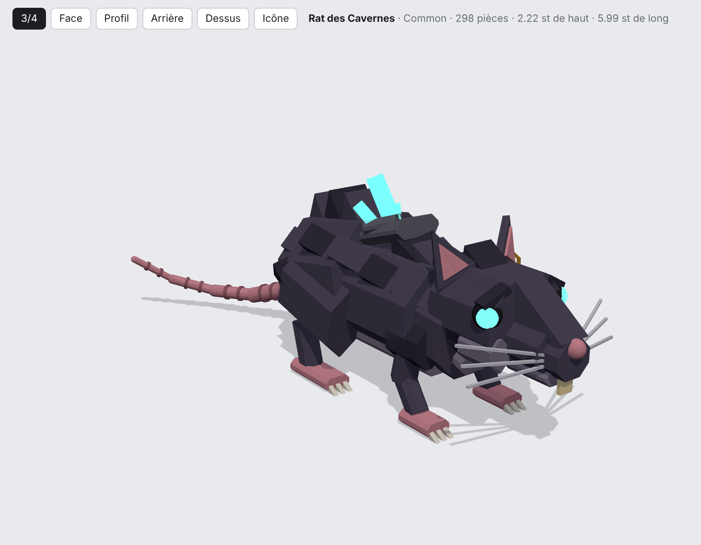
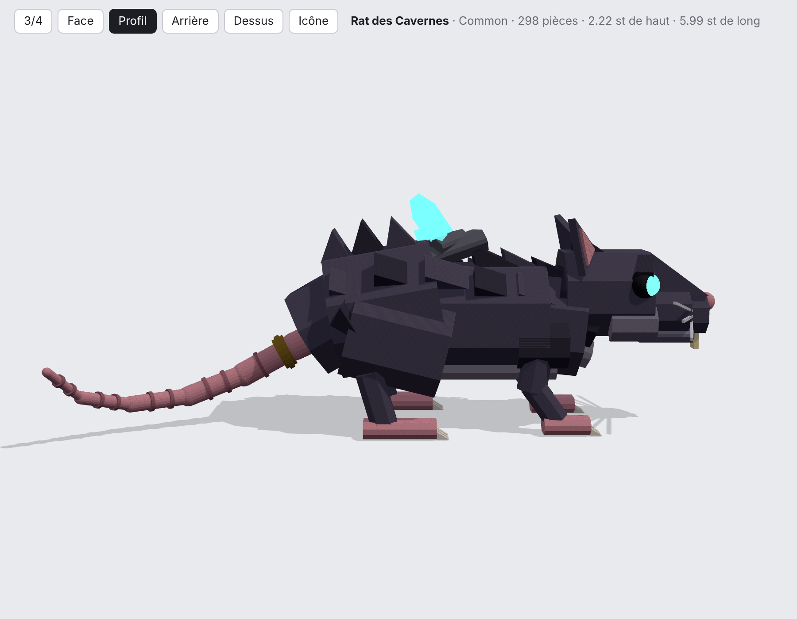
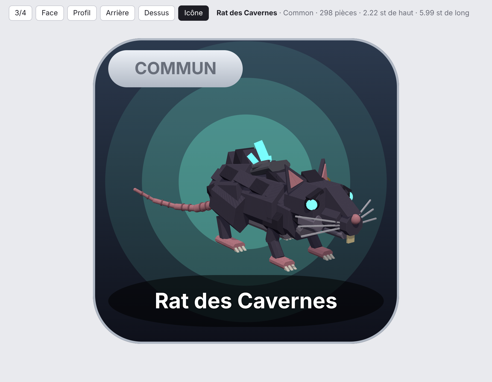

# CreatureForge — bestiaire low-poly pour Roblox

Des créatures 3D low-poly détaillées, assemblées **entièrement en code Luau** (Part, WedgePart,
matériaux Roblox, Neon, particules, lumières), articulées par **Motor6D** et animées de façon
procédurale, chacune avec son **icône UI** (UICorner + UIGradient + ViewportFrame).

| 3/4 | Profil | Icône |
| --- | --- | --- |
|  |  |  |

> Aperçus rendus hors de Studio par `tools/preview/viewer.html` (approximation : dans Roblox,
> l'éclairage, les textures Fabric/Slate et les particules rendent différemment).

## Progression (1 / 21)

> Répartition des raretés provisoire pour les groupes « Rares & Épiques » et « Légendaires & Mythiques ».

| # | Créature | Rareté | État |
| --- | --- | --- | --- |
| 1 | Le Rat des Cavernes | Commun | ✅ `src/shared/Creatures/RatDesCavernes.luau` |
| 2 | Le Lézard Mousseux | Commun | ⏳ |
| 3 | Le Corbeau des Brumes | Commun | ⏳ |
| 4 | Le Pousse-Pierre | Commun | ⏳ |
| 5 | Le Lapin Solaire | Commun | ⏳ |
| 6 | Le Renard des Cendres | Inhabituel | ⏳ |
| 7 | Le Sanglier Runique | Inhabituel | ⏳ |
| 8 | Le Serpent d'Améthyste | Inhabituel | ⏳ |
| 9 | Le Hibou des Glaces | Inhabituel | ⏳ |
| 10 | La Tortue de Magma | Inhabituel | ⏳ |
| 11 | Le Loup des Fagnes | Inhabituel | ⏳ |
| 12 | Le Faucon de Cristal | Rare | ⏳ |
| 13 | L'Ours Runique | Rare | ⏳ |
| 14 | La Salamandre de Feu | Rare | ⏳ |
| 15 | Le Cerf Céleste | Épique | ⏳ |
| 16 | Le Chat des Abysses | Épique | ⏳ |
| 17 | Le Sanglier Ancestral | Épique | ⏳ |
| 18 | Le Phénix Cendré | Légendaire | ⏳ |
| 19 | Le Léviathan des Profondeurs | Légendaire | ⏳ |
| 20 | Le Mammouth Steampunk | Mythique | ⏳ |
| 21 | Le Néant Couronné | Mythique | ⏳ |

## Le Rat des Cavernes (Commun)

Petit rongeur agile aux yeux lumineux, corps sombre texturé et petites oreilles pointues.

- **298 pièces** (152 Part + 162 WedgePart, prismes octogonaux chanfreinés), ~2,2 × 2,3 × 6 studs à `scale = 1`.
- **Matériaux** : Fabric (fourrure), SmoothPlastic (peau, dents, griffes), Neon (yeux, cristaux),
  Slate (plaque de roche), Metal (anneau d'oreille et bague de queue dorés).
- **Ornements** : plaque de roche + 3 cristaux de grotte sur le dos, anneau doré à l'oreille gauche,
  bague dorée sur la queue annelée, moustaches, incisives, sourcils, joues, 12 griffes.
- **Effets** : poussière de grotte au sol, éclats lumineux dans les yeux, spores qui montent des
  cristaux, 2 PointLights (yeux + cristaux), contour cartoon (Highlight).
- **Squelette** : `Root > Body > Head > Ear_R/Ear_L`, `Body > Tail1…Tail6`, `Body > Leg_FR/FL/BR/BL`
  (14 Motor6D) — compatible avec l'Animation Editor de Roblox.
- **Animation procédurale** : respiration, reniflements, regard, frémissement d'oreilles,
  queue ondulante (Idle) ; trot diagonal + rebond (Move) ; pose figée (Still).

## Utilisation dans Roblox Studio

### Option 1 — Command Bar (le plus rapide)

1. Ouvrez `dist/RatDesCavernes.commandbar.luau`, copiez **tout** le contenu.
2. Studio : *View › Command Bar*, collez, **Entrée**.
3. Le rat apparaît devant la caméra (sélectionné, annulable avec Ctrl+Z) et son icône
   s'affiche dans `StarterGui › CreatureForgeIcons`.

### Option 2 — Fichiers modèle

- Glissez `dist/RatDesCavernes.rbxmx` dans la fenêtre 3D de Studio → le modèle.
- Glissez `dist/RatDesCavernes_Icon.rbxmx` sur `StarterGui` → la carte d'icône.

### Option 3 — Projet complet avec Rojo (recommandé pour le jeu)

```bash
rojo serve        # puis « Connect » dans le plugin Rojo de Studio
```

| Instance Studio | Source |
| --- | --- |
| `ReplicatedStorage.CreatureForge` | `src/shared/` (Kit, Fx, Icon, Rarity, Types, Creatures/) |
| `ServerScriptService.CreatureShowcase` | `src/server/` — démo : fait apparaître et promener les créatures |
| `StarterPlayerScripts.CreatureAnimator` | `src/client/` — animation procédurale (Motor6D.Transform) |
| `StarterPlayerScripts.CreatureBestiary` | `src/client/` — démo UI : bouton « Bestiaire » + grille d'icônes |

```lua
local CreatureForge = require(game.ReplicatedStorage.CreatureForge)

local rat = CreatureForge.spawn("RatDesCavernes", CFrame.new(0, 0, -10), {
	scale = 1.5,      -- taille
	outline = true,   -- contour cartoon (Highlight : 31 max affichés à la fois)
	effects = true,   -- particules + lumières
})
CreatureForge.setAnimState(rat, "Move")             -- "Idle" | "Move" | "Still"
CreatureForge.buildIcon("RatDesCavernes", someFrame) -- carte carrée qui remplit sa cellule
```

## Architecture

```
src/shared/
  init.luau        registre + spawn/buildIcon/setAnimState
  Kit.luau         rig (os Motor6D), pièces soudées, primitives low-poly :
                   prism (octogone chanfreiné), wedgeTri, spike, thorn, ring, shard, cylinder, strut
  Fx.luau          particules / lumières (textures moteur rbxasset://, aucun asset à téléverser)
  Icon.luau        carte d'icône : UICorner, UIGradient, UIStroke, ViewportFrame cadré automatiquement
  Rarity.luau      Commun → Mythique (libellés + couleurs)
  Types.luau       contrat CreatureDef / AnimProfile / IconTheme
  Creatures/       une créature = un ModuleScript (auto-enregistré)
tools/
  export.luau      → dist/<Id>.rbxmx, dist/<Id>_Icon.rbxmx, tools/preview/<Id>.json
  bundle.luau      → dist/<Id>.commandbar.luau (script autonome)
  preview/viewer.html  aperçu 3D web (three.js) avec vue « Icône »
```

Conventions du Kit : la créature regarde vers **-Z**, +X est sa droite, le sol est à Y = 0 et
toutes les coordonnées sont écrites à `scale = 1` (le Kit applique l'échelle).

### Régénérer les fichiers `dist/` et les aperçus

Nécessite [Lune](https://github.com/lune-org/lune) (`cargo install lune`) :

```bash
lune run tools/export   # modèles .rbxmx + données d'aperçu
lune run tools/bundle   # scripts Command Bar
cd tools/preview && python3 -m http.server 8000
# puis ouvrez http://localhost:8000/viewer.html?id=RatDesCavernes
```
